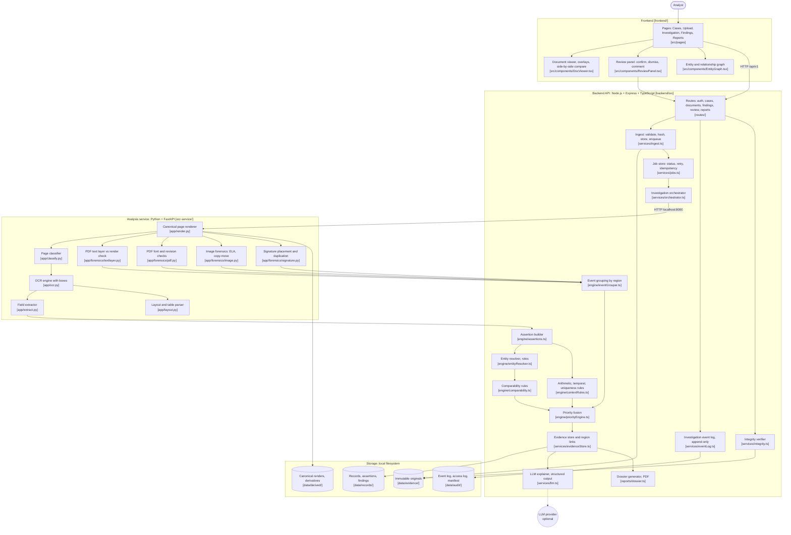
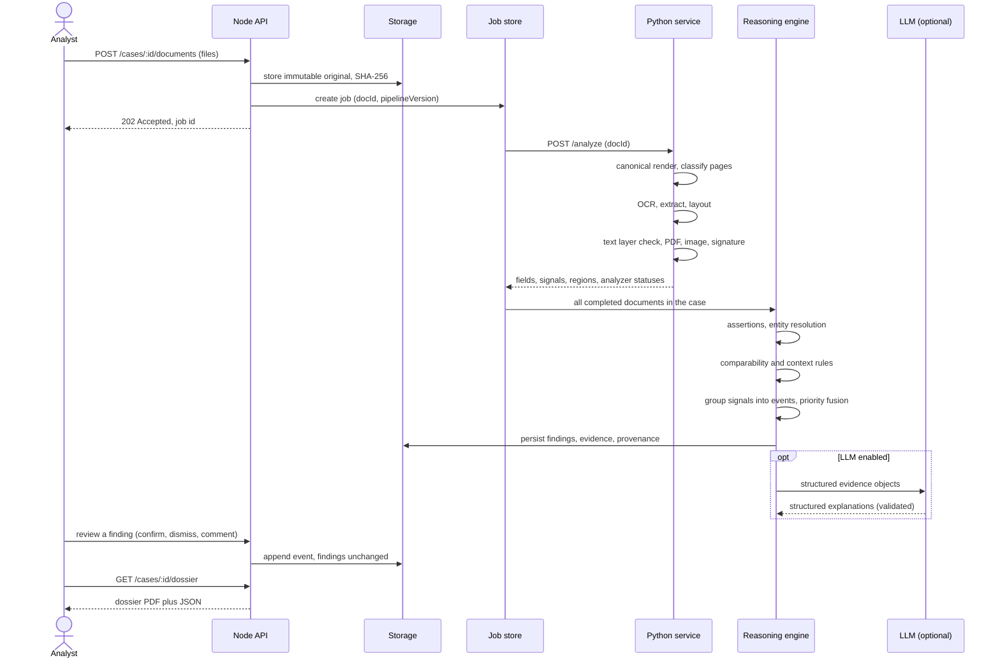

# TraceDocs: Architecture (v2)

AI-assisted document forensics and contextual intelligence. TraceDocs takes related scanned and digital documents, preserves them as hashed evidence, extracts structured assertions with locations, runs forensic and context-aware consistency checks, and produces an investigation dossier in which every finding traces back to a region of an original document and every analyst decision is recorded.

> Status labels in this file describe the **design**. The integration status matrix (section 14) is the only place that states what actually works, and it must be updated truthfully as the build progresses.

### Changes from v1

- Contextual reasoning is now the central layer: **semantic assertions, entity roles and a comparability table** replace plain pairwise field matching.
- **Review workflow** added: analyst decisions are stored separately from machine observations, in an append-only event log.
- Field confidence split into OCR confidence, extraction confidence and validation status.
- Forensic signals are **grouped by region into events** before fusion, so correlated detectors are not counted as independent evidence.
- LLM output is **structured and bound to evidence IDs**; intent attribution is banned.
- Added: canonical page render, PDF text-layer vs rendering check, job handling, evaluation plan, provenance fields, `UNKNOWN`/`AMBIGUOUS` classification.
- Forensic scope reduced to a core set of detectors that will actually be tested.

---

## 1. Design principles

1. **Checks produce evidence, the LLM only explains it.** Findings come from deterministic analyzers and rules. The LLM never creates, removes or re-scores a finding.
2. **Context decides whether a difference matters.** Two values differing is not a finding by itself. A finding exists only when the comparability rules say the values should agree.
3. **OCR output is a claim, not ground truth.** Every field carries separate confidences and a region, and a digital PDF's text layer is verified against its rendering.
4. **Observation, review and inference are separate.** Machine observation (`ObservationStatus`) and analyst decision (`ReviewStatus`) are different fields. Neither overwrites the other.
5. **No intent, no fraud verdicts.** The system reports observed inconsistencies and potential anomalies. It never states or implies that someone modified a document deliberately.
6. **Missing evidence is not clean evidence.** An analyzer that failed or did not apply is `UNAVAILABLE` or `NOT_APPLICABLE`, never `CLEAN`.
7. **Priority is not probability.** The output is an *investigation priority* for ordering analyst attention. It is not a calibrated probability of fraud.
8. **Everything traces to a region.** Finding to evidence to `(docId, page, bbox)` on the canonical render to the original file hash.
9. **Fail safe and say so.** Unsupported formats, failed OCR and timeouts produce explicit statuses and appear in the dossier's limitations.

---

## 2. System overview



The Node API owns cases, evidence, reasoning, review and reporting. The Python service is stateless: it receives a file by ID (never a filesystem path), returns JSON and stores nothing except canonical renders written to the derived folder.

---

## 3. Components

Origin: **Reused** means copied from TraceMail with minor edits, **Adapted** means structure carries over but logic changes, and **New** means built for this project. Pre-existing code must be disclosed in the README.

### 3.1 Ingestion and jobs (Node)

| Component | Responsibility | Origin |
| --- | --- | --- |
| Upload API | Accept PDF, PNG, JPG, TIFF; type and size limits; optional `caseId` | Adapted (TraceMail accepts only `.eml`) |
| Hashing | SHA-256 of the original bytes, stored in the manifest | Reused |
| Immutable originals | Originals are write-once; all derivatives live in a separate folder | New |
| Case grouping | Several documents under one application or transaction | Adapted |
| Job store | Persistent per-document and per-case job status (`QUEUED`, `RUNNING`, `PARTIAL`, `DONE`, `FAILED`), retry with limit, analyzer timeouts, idempotent re-runs keyed by `(docId, pipelineVersion)` | New |
| Integrity verifier | Recompute hashes, compare with the manifest, report PASS or FAIL | New |

### 3.2 Document intelligence (Python)

| Component | Responsibility | Candidate tools |
| --- | --- | --- |
| Canonical renderer | Render every page to one fixed-DPI, upright image. All boxes and overlays use this render's coordinate space, with rotation and deskew angles recorded per page | PyMuPDF, OpenCV |
| Page classifier | Classify each **page** as `id_card`, `application_form`, `bank_statement`, `other`, `UNKNOWN` or `AMBIGUOUS`, with confidence. A multi-page PDF can contain several document types | Keyword and layout heuristics first |
| OCR engine | Words and lines with boxes and OCR confidence | PaddleOCR primary, Tesseract fallback |
| Field extractor | Map OCR output to the per-type schema, with extraction confidence | Regex and position anchors; LLM only as an optional helper |
| Layout parser | Sections, key-value pairs and tables | Heuristics on OCR geometry, PyMuPDF |

Classification below the confidence threshold is `UNKNOWN` or `AMBIGUOUS`. The analyst can correct the type in the UI, and the correction is logged and triggers a re-run.

### 3.3 Forensic analyzers (Python)

**Core set (will be built and tested against the sample dataset):**

| Analyzer | What it checks | Applies to |
| --- | --- | --- |
| Text layer vs render | OCR the rendered page and diff it against the PDF text layer to expose hidden, overlaid or stale text | Digital PDFs |
| PDF fonts and revisions | Per-span font, size and colour outliers within a row or block; producer and date metadata; number of incremental revisions | Digital PDFs |
| Image forensics | ELA residual map, copy-move via keypoint matching, with baseline comparison against the page | Images and scanned pages |
| Signature | Region present, placed in the expected zone, and not a near-duplicate of a signature in another document | ID cards, forms |

**Stretch (only if the core set is working and tested):** local noise variance, OCR-geometry alignment and spacing outliers, photo-region edge discontinuity, PDF object and overlay analysis, template comparison.

Every forensic result is `POTENTIAL_ANOMALY`. Each analyzer documents what it can and cannot detect in `docs/LIMITATIONS.md`.

### 3.4 Reasoning engine (Node)

| Component | Responsibility | Origin |
| --- | --- | --- |
| Assertion builder | Turn extracted fields into `DocumentAssertion` objects with semantic type, entity reference and dates | New |
| Entity resolver | Group assertions into entities with roles; never merge on name similarity alone; keep an explicit unresolved state | New |
| Comparability rules | Table of which semantic types must agree, may differ or are not comparable | New |
| Context rules | Arithmetic (totals vs items), temporal (issue vs claimed dates), uniqueness (same identifier, different people) | New |
| Event grouper | Cluster overlapping forensic signals on the same region into one event | New |
| Priority fusion | Combine events and rule findings into per-document and per-case priority | Adapted (noisy-OR, caps, coverage from TraceMail) |
| Evidence store | Persist findings, evidence, provenance and region links | Adapted |
| LLM explainer | Structured explanations bound to evidence IDs; provider-agnostic, optional | Reused |

### 3.5 Review and output (React and Node)

| Component | Responsibility | Origin |
| --- | --- | --- |
| Document viewer | Pages with finding overlays; click a finding to jump to its box | New |
| Side-by-side compare | Two documents with the conflicting regions highlighted together | New |
| Review panel | Confirm, dismiss, mark inconclusive, comment, reopen | New |
| Event log | Append-only record of uploads, re-runs, reclassifications, reviews and exports | Adapted (access log) |
| Entity graph | Documents and entities as nodes, matches and conflicts as edges (Cytoscape) | Adapted |
| Dossier generator | Server-side PDF covering sections 7.1 to 7.6 of the problem statement, including review outcomes | New |

---

## 4. Processing sequence



Analyzer failures never abort the run. The analyzer reports `ERROR` or `UNAVAILABLE`, the job ends `PARTIAL` instead of `FAILED`, and the dossier lists the gap. Re-running the same `(docId, pipelineVersion)` returns the existing result unless the analyst forces a new run, which is logged.

---

## 5. Data model

All coordinates are normalized to the **canonical render** of a page (0 to 1). Each page records the rotation and deskew applied to its original so a region can be mapped back to the source file.

```ts
type ObservationStatus = "OBSERVED" | "INCONSISTENT" | "POTENTIAL_ANOMALY" | "INCONCLUSIVE";
type ReviewStatus      = "UNREVIEWED" | "CONFIRMED" | "DISMISSED" | "INCONCLUSIVE";
type AnalyzerStatus    = "AVAILABLE" | "UNAVAILABLE" | "ERROR" | "NOT_APPLICABLE";

interface Region {
  docId: string;
  page: number;                       // 1-based
  bbox: [x: number, y: number, w: number, h: number];
  label?: string;
}

interface PageRecord {
  docId: string;
  page: number;
  renderPath: string;                 // canonical render, derived folder
  renderDpi: number;
  rotationDeg: number;                // applied to reach upright
  deskewDeg: number;
  docType: "id_card" | "application_form" | "bank_statement" | "other" | "UNKNOWN" | "AMBIGUOUS";
  docTypeConfidence: number;
  docTypeOverriddenBy?: string;       // analyst id if corrected
}

interface DocumentRecord {
  docId: string;
  caseId: string;
  filename: string;
  sha256: string;
  mimeType: string;
  pageCount: number;
  processing: Record<string, AnalyzerStatus>;
  pipelineVersion: string;
  receivedAt: string;                 // ISO timestamp
}

interface ExtractedField {
  fieldId: string;
  docId: string;
  name: string;                       // "full_name", "dob", "address", ...
  rawValue: string;                   // exactly as read
  normalizedValue: string | null;
  ocrConfidence: number;              // how well the engine read the characters
  extractionConfidence: number;       // how sure we are this text is this field
  validationStatus: "VALID" | "INVALID_FORMAT" | "NOT_CHECKED";
  region: Region;
  source: "ocr" | "pdf_text_layer";
}

interface DocumentAssertion {
  assertionId: string;
  caseId: string;
  docId: string;
  fieldId: string;
  entityId: string | null;            // null until resolved
  entityRole: "applicant" | "co_applicant" | "guarantor" | "nominee" | "account_holder" | "unknown";
  semanticType: string;               // "dob", "address_permanent", "address_current",
                                      // "requested_amount", "account_balance", "id_number", ...
  normalizedValue: string | null;
  documentDate?: string;              // when the document was issued
  effectiveDate?: string;             // when the information applies
  extractionConfidence: number;
  region: Region;
}

interface Entity {
  entityId: string;
  caseId: string;
  role: DocumentAssertion["entityRole"];
  resolution: "RESOLVED" | "SUGGESTED" | "UNRESOLVED";
  basis: string[];                    // e.g. ["id_number exact match"]
  assertionIds: string[];
}

interface Provenance {
  analyzer: string;
  analyzerVersion: string;
  modelVersion?: string;
  config: Record<string, number | string>;   // thresholds used
  inputSha256: string;
  processedAt: string;
  status: AnalyzerStatus;
}

interface Evidence {
  evidenceId: string;
  kind: "assertion_pair" | "forensic_signal" | "metadata" | "rule_result" | "text_layer_diff";
  description: string;
  regions: Region[];
  assertionIds?: string[];
  measurements?: Record<string, number | string>;
  provenance: Provenance;
}

interface Finding {
  findingId: string;
  caseId: string;
  category: "extraction" | "visual" | "pdf_structure" | "context" | "cross_document";
  type: string;                       // "DOB_CONFLICT", "TEXT_LAYER_MISMATCH", "REGION_EVENT", ...
  observationStatus: ObservationStatus;   // machine output, never edited
  severity: "info" | "low" | "medium" | "high";
  confidence: number;                 // kept separate from severity
  evidence: Evidence[];
  explanation?: StructuredExplanation;
  needsVerification: string[];
}

interface InvestigationEvent {         // append-only
  eventId: string;
  caseId: string;
  at: string;
  actor: string;
  type: "UPLOAD" | "RERUN" | "RECLASSIFY" | "REVIEW" | "COMMENT" | "REOPEN" | "EXPORT" | "VIEW";
  targetId: string;                   // docId, findingId, ...
  payload: Record<string, unknown>;   // e.g. { status: "DISMISSED", reason: "..." }
}
```

The effective review state of a finding is derived by replaying its events. The finding record itself is never modified by a review.

### Example finding

```json
{
  "findingId": "F-0007",
  "caseId": "CASE-001",
  "category": "cross_document",
  "type": "DOB_CONFLICT",
  "observationStatus": "INCONSISTENT",
  "severity": "high",
  "confidence": 0.86,
  "evidence": [
    {
      "evidenceId": "E-0012",
      "kind": "assertion_pair",
      "description": "dob differs for the same resolved applicant (rule: MUST_AGREE)",
      "regions": [
        { "docId": "D-01", "page": 1, "bbox": [0.12, 0.31, 0.20, 0.04] },
        { "docId": "D-02", "page": 1, "bbox": [0.18, 0.22, 0.22, 0.03] }
      ],
      "assertionIds": ["A-014", "A-031"],
      "measurements": { "valueA": "2004-08-12", "valueB": "2001-08-12", "entityResolution": "RESOLVED" },
      "provenance": { "analyzer": "comparability", "analyzerVersion": "0.1", "config": {}, "inputSha256": "...", "processedAt": "...", "status": "AVAILABLE" }
    }
  ],
  "needsVerification": ["Inspect both date-of-birth regions on the original documents"]
}
```

---

## 6. Forensic check catalogue

| Check | Method | Output | Main false-positive risk |
| --- | --- | --- | --- |
| Text layer vs render | OCR the render, compare with PDF text layer, flag text present in one but not the other | Region-level diff | Invisible but legitimate text such as OCR layers added to scans |
| PDF fonts | Compare font, size and colour of a value with its row and neighbours | Span regions | Legitimate bold or highlighted values |
| PDF revisions | Count `%%EOF` markers, compare producer and creation vs modification dates | Metadata evidence (weak on its own) | Legitimate re-export or form fill |
| ELA | Re-save JPEG at a known quality, compare residual per block against the page baseline, cluster high-residual blocks | Candidate regions | Any recompressed image; never read in isolation |
| Copy-move | Keypoint matching within one image, cluster matches with consistent offset | Matched region pairs | Repeated logos, stamps, patterns |
| Signature | Present, inside expected zone, near-duplicate across documents | Placement and duplication findings | People sign similarly; similarity is not forgery |

None of these establishes that a document was manipulated. Each reports a signal with measurements.

---

## 7. Contextual reasoning

This layer decides whether a difference *matters*. It runs on assertions, not raw field strings.

### 7.1 Entity resolution

- Strong identifiers (ID number, account number) resolve entities by exact match.
- Name similarity alone only produces a `SUGGESTED` link, never a merge. Similar-looking names in one case may be different people.
- Roles come from the document type and layout (applicant on the application form, account holder on a statement, and so on). An unclear role stays `unknown`.
- Anything that cannot be resolved stays `UNRESOLVED` and is shown to the analyst. Findings that depend on an unresolved entity link are capped at low confidence and say so.

### 7.2 Comparability table

| Rule type | Meaning | Example | Result if values differ |
| --- | --- | --- | --- |
| `MUST_AGREE` | Same entity, same semantic type, same time frame | `dob` on ID vs form; `id_number`; `full_name` (fuzzy) | `INCONSISTENT` finding |
| `MAY_DIFFER` | Legitimately different | `address_permanent` vs `address_current` | No finding; an info note at most |
| `NOT_COMPARABLE` | Different concepts | `requested_amount` vs `account_balance` | No comparison made |
| `ARITHMETIC` | Internal calculation | Statement total vs sum of transactions | `INCONSISTENT` finding |
| `TEMPORAL` | Date logic | Document issued after the date it certifies; age vs DOB | `INCONSISTENT` finding |
| `UNIQUENESS` | One identifier, one entity | Same `id_number` under two different people | `POTENTIAL_ANOMALY` finding |

The table is data, not code: each row names the semantic types, the entity roles it applies to and the matching method. Rows are added per document type and documented.

### 7.3 Matching methods

- Names: normalize case, punctuation and honorifics, then token-sort fuzzy ratio. At or above 92 counts as a match, 75 to 92 as a low-severity "variant spelling", below 75 as a conflict. Thresholds are untuned starting values.
- Dates: parse to ISO. A day/month swap is reported as its own likely-transcription type.
- IDs and amounts: exact.
- Addresses: only compared when both assertions have the same semantic type.

### 7.4 What a finding must carry

A reasoning finding records the rule that fired, the entity and its resolution state, both assertions with their extraction confidences, and why the legitimate-difference rules did not apply. This is what the explanation is built from.

---

## 8. Priority model

Output is an **investigation priority**, not a fraud probability.

1. **Events.** Forensic signals whose regions overlap (IoU above a threshold, initially 0.3) on the same page are merged into one *event*. Three detectors flagging one box produce one event with three supporting signals. Event confidence is the maximum member confidence, plus a small agreement bonus for distinct detector families.
2. **Per category.** Noisy-OR over event and finding confidences, each scaled by severity weight. Initial weights: info 0.05, low 0.15, medium 0.40, high 0.70.
3. **Weak-evidence cap.** A category containing only info or low items cannot exceed the `moderate` band.
4. **Across categories.** Weighted combination. Coverage is the share of expected analyzers that ran. The expected list is configuration (`backend/config/engine.json`, `priority.expectedAnalyzers`), not whatever the analysis service happens to report: an expected analyzer a document does not report counts as UNAVAILABLE, so a check that was never built or never ran is missing, not clean. NOT_APPLICABLE is excluded, and so is a family (the first dotted segment, such as `pdf`) for which every reported member is NOT_APPLICABLE on that document. A missing analyzer contributes nothing and lowers coverage; it never changes the score or the band. Below `priority.lowCoverageBelow` (0.75) the result carries `incompleteCoverage: true` and lists `missingAnalyzers`, and reports say that a low band is then not an all-clear.
5. **Bands.** Low below 0.25, moderate below 0.50, high below 0.75, critical otherwise. Confidence and coverage are reported as separate numbers.

All weights and thresholds are starting values and are recorded in each provenance block. They are validated only against the sample dataset and described that way.

---

## 9. LLM boundary

- **Sent to the provider:** serialized finding and evidence objects, meaning extracted values, measurements and region labels. Original files and page images are never sent.
- **Required output:** structured JSON referencing existing IDs:

```json
{
  "findingId": "F-0007",
  "summary": "Date of birth differs across documents.",
  "observations": ["ID card reads 12/08/2004.", "Application reads 12/08/2001."],
  "possibleExplanations": ["Transcription error", "Incorrect information in one document"],
  "recommendedReview": ["Inspect both date-of-birth regions."],
  "evidenceIds": ["E-0012"]
}
```

- **Validation:** `findingId` and every `evidenceId` must exist; every value quoted in `observations` must appear in the referenced evidence; the text is scanned for intent or accusation language ("intentionally", "forged", "fraudulent", "deliberately"), and a match replaces the explanation with a template. Findings are unchanged either way.
- Provider-agnostic and off by default. The system works fully without it. Because extracted values leave the machine when it is on, use only fictional or authorized documents and state this in the limitations.

---

## 10. Review workflow

| Action | Effect |
| --- | --- |
| Confirm | Analyst agrees the observation is valid (`REVIEW` event, status `CONFIRMED`) |
| Dismiss | False positive, with a required reason (`DISMISSED`) |
| Mark inconclusive | Not enough information (`INCONCLUSIVE`) |
| Comment | Free text attached to a finding or document |
| Reopen | Returns the finding to `UNREVIEWED` |
| Reclassify document | Corrects page type, logs the change, triggers a re-run |
| Side-by-side compare | Opens the two conflicting regions together |

Reviews are events. The machine `observationStatus` is shown next to the review status and is never edited. The dossier reports both, plus the review history.

---

## 11. API surface (`/api/v1`)

| Method | Route | Description |
| --- | --- | --- |
| `POST` | `/auth/login`, `/auth/logout` | Analyst session |
| `GET` | `/cases` | List cases with case-level priority (needed by the Cases page) |
| `POST` | `/cases` | Create a case |
| `POST` | `/cases/:caseId/documents` | Upload documents, returns job IDs |
| `GET` | `/jobs/:jobId` | Job status, per-analyzer progress, partial results |
| `GET` | `/cases/:caseId` | Case summary, documents, case-level priority |
| `GET` | `/documents/:docId` | Record, pages, per-analyzer status |
| `PATCH` | `/documents/:docId/pages/:n/type` | Analyst reclassification (logged) |
| `GET` | `/documents/:docId/pages/:n/render` | Canonical page render |
| `GET` | `/cases/:caseId/assertions` | Assertions with entity links |
| `GET` | `/cases/:caseId/entities` | Resolved, suggested and unresolved entities |
| `GET` | `/cases/:caseId/findings` | Findings, filter by category, observation and review status |
| `GET` | `/findings/:findingId` | Finding, evidence, regions, review history |
| `POST` | `/findings/:findingId/review` | Confirm, dismiss, inconclusive, comment, reopen |
| `GET` | `/cases/:caseId/graph` | Entity and document graph |
| `GET` | `/cases/:caseId/events` | Append-only investigation log |
| `GET` | `/cases/:caseId/dossier` | Dossier PDF, `?format=json` for raw structure |
| `GET` | `/cases/:caseId/integrity` | Re-verify hashes against the manifest |
| `GET` | `/cases/:caseId/related` | Other cases sharing an id_number, account_number or file hash (a lead, not a finding) |
| `GET` | `/compliance/retention-policy` | Configured retention policy (reporting only, no purge) |

Python service (internal, localhost only, takes document IDs not paths): `POST /analyze`, `GET /health`.

---

## 12. Evaluation plan

The sample set is split into a **development set** (used to design rules and thresholds) and a **held-out test set** (never used for tuning). Ground truth is a written list of exactly what was tampered with, where, and every legitimate difference placed on purpose.

| Component | Metric |
| --- | --- |
| Page classification | Accuracy, per-class recall |
| OCR | Character and word error rate on the samples |
| Field extraction | Field-level exact match |
| Boxes | IoU against annotated regions |
| Forensic detectors | Precision, recall and false-positive count per detector |
| Context rules | Conflict precision and recall |
| Traceability | Share of findings whose region lands on the correct source area |
| Pipeline | Processing time, failure and partial-result rate |

Required test cases:

1. Genuine documents with **legitimate differences** (current vs permanent address, loan amount vs balance).
2. Genuine documents with transcription errors.
3. Documents with real contradictions (DOB, name, ID number).
4. Multiple people in one case (applicant and guarantor).
5. Tampered documents **with** a cross-document inconsistency.
6. Tampered documents **without** any cross-document inconsistency.

Cases 1, 4 and 6 are the ones that show whether the system reasons or merely compares. Results are reported as measured on a small synthetic set, with no claim of general accuracy.

---

## 13. Repository layout

```
tracedocs/
├── frontend/            React + Vite + TypeScript + Tailwind (+ Cytoscape)
├── backend/             Express + TypeScript API
│   └── src/
│       ├── routes/      auth, cases, documents, findings, review, reports
│       ├── services/    ingest, jobs, orchestrator, evidenceStore, eventLog, integrity, llm
│       ├── engine/      assertions, entityResolver, comparability, contextRules,
│       │                eventGrouper, priorityEngine
│       └── reports/     dossier generator
├── ocr-service/         Python + FastAPI
│   └── app/             render, classify, ocr, extract, layout, forensics/
├── samples/
│   ├── dev/             Fictional documents used while building
│   ├── test/            Held-out documents, not used for tuning
│   └── ground-truth.md  Exactly what was tampered and what is legitimately different
├── eval/                Scripts and results for section 12 metrics
├── docs/                ARCHITECTURE.md, LIMITATIONS.md, INTEGRATION_STATUS.md
└── README.md            Setup, dependencies, licensing, TraceMail lineage disclosure
```

---

## 14. Integration status matrix (to be kept truthful)

| Capability | Status | Notes |
| --- | --- | --- |
| Upload, hashing, immutable originals, case grouping | Planned | Adapted from TraceMail |
| Job store, retry, partial results | Planned | JSON-persisted, no external queue |
| Canonical render with rotation records | Planned | |
| OCR with boxes | Planned | PaddleOCR primary, Tesseract fallback |
| Page classification with UNKNOWN/AMBIGUOUS | Planned | Heuristic; manual correction |
| Field extraction | Planned | Per-type schemas for the demo document types only |
| Assertions and entity roles | Planned | |
| Comparability and context rules | Planned | Table covers demo document types only |
| Text layer vs render check | Planned | Digital PDFs only |
| PDF font and revision checks | Planned | |
| Image forensics (ELA, copy-move) | Planned | Documented false-positive risk |
| Signature placement and duplication | Planned | Does not assess authenticity |
| Photo-replacement detection | Unsupported | Stretch goal, not committed |
| Noise, alignment, template analysis | Unsupported | Stretch goals, not committed |
| Handwriting recognition | Unsupported | Out of scope |
| Multilingual OCR | Unsupported | English only |
| Region-grouped priority fusion | Planned | Adapted from TraceMail |
| Review workflow and event log | Planned | |
| LLM structured explanations | Planned | Optional |
| Dossier PDF | Planned | Server-side |
| Review UI with overlays and compare | Planned | |
| Evaluation harness | Planned | |

Replace "Planned" with Implemented, Partial or Unsupported as the build proceeds. Never describe a capability as implemented unless it runs in the live demo.

---

## 15. Safety, scope and limitations

- Fictional or explicitly authorized documents only. No real customer data.
- Findings are observations and potential anomalies, never fraud verdicts, and a human makes consequential decisions.
- Evidence is hashed on ingest and can be re-verified. This supports chain-of-custody practice but is not claimed to be court-certified.
- Forensic detectors produce false positives, especially on recompressed or textured images. Signature similarity does not establish forgery, and PDF metadata alone is weak evidence.
- OCR errors on poor scans propagate downstream, so confidences are carried through to every finding.
- Entity resolution is conservative by design and will leave real matches unresolved rather than merge wrongly.
- Matching thresholds, severity weights and priority bands are untuned starting values validated only on a small synthetic set.
- Sessions and storage inherit TraceMail's single-analyst, filesystem-based design. Encryption at rest, per-user authorization, parser sandboxing and multi-instance deployment are out of scope for this prototype and are not claimed.
- When the optional LLM is enabled, extracted values (not files or images) are sent to the configured provider.

---

## 16. Standards and references

Used as guidance, with no claim of formal compliance: ISO/IEC 27037 (evidence preservation, mapped to immutable originals, hashing and the manifest), ISO/IEC 27041 and 27042 (method suitability and analysis and interpretation, mapped to documented detectors, limitations and the evaluation plan), NIST SP 800-86 (forensic techniques in incident response), OWASP Machine Learning Security Top 10 (applied to the LLM boundary and model inputs).
